# Selfhosted Secure Messenger

A self-hosted, end-to-end encrypted messenger for **Android** and **Linux**. You run the server; the server only ever stores ciphertext.

<p>
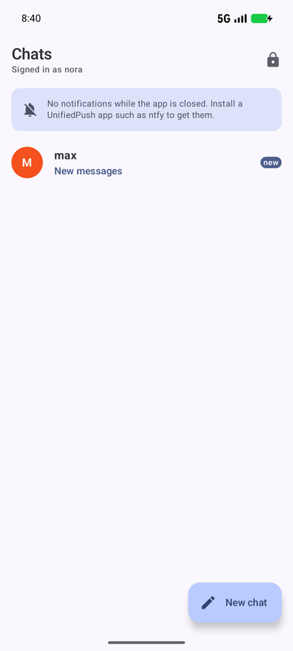
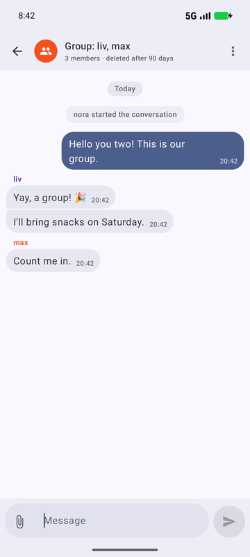
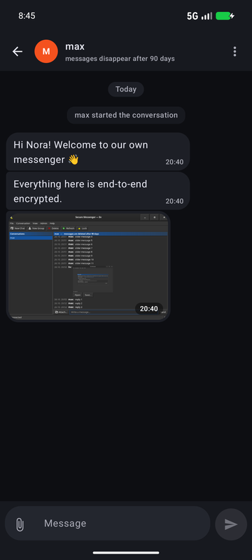
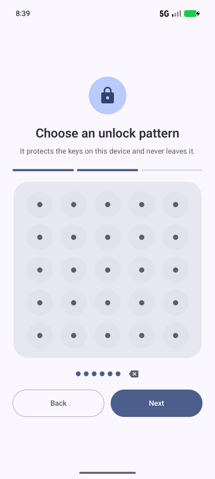
</p>

**How the security works, with diagrams:** [docs/SECURITY.md](docs/SECURITY.md)

## Features

**Privacy and security**
- End-to-end encryption with Olm/Megolm ([vodozemac](https://github.com/matrix-org/vodozemac)); group keys rotate when members change
- No message history on the devices: clients load ciphertext from the server and decrypt it in memory only
- Unlock with a pattern on a 5×5 grid (any order, repeats allowed), Argon2id key derivation, increasing wait after wrong attempts
- Keys bound to the phone's secure hardware (Android Keystore/StrongBox) and optionally to the PC's TPM2 — fully usable without a TPM
- Every new device must be approved by an administrator (with fingerprint check); accounts only via invitation code
- Screenshot protection on Android, push notifications without content (UnifiedPush, FCM fallback)

**Messaging**
- Direct chats and groups (group admin invites, anyone can leave)
- Encrypted pictures and files with small encrypted previews; originals only on demand; saving shows a warning
- Delete **for everyone** only — one message, several selected ones, or the whole chat; any member may delete
- Messages disappear after a per-chat retention period (1–365 days, default 90), announced to all members

**Administration**
- Admin panel in the Linux client and the Android app (own admin key and pattern): approve/revoke devices, create accounts and invitation codes, lock accounts, manage admins, delete everything a person sent, delete accounts
- `sudo ssm-tui` terminal interface on the server, including a Server tab to choose the port and whether the server is reachable from the LAN
- Hash-chained, append-only audit log

**Operations**
- One-command server install (PostgreSQL, systemd sandbox), LAN mode, HTTPS via Caddy/Let's Encrypt
- Encrypted daily backups (age); restores re-apply deletions made since the backup
- Signed Android releases with downgrade protection; follows the system's dark mode and colours on Android and Linux

## Screenshots

| Android | | |
|---|---|---|
| 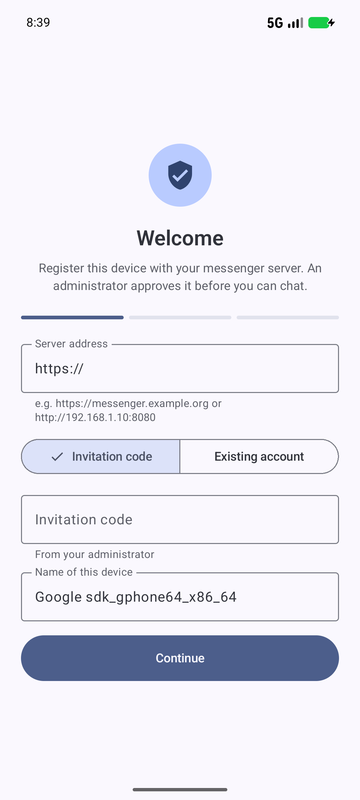 | 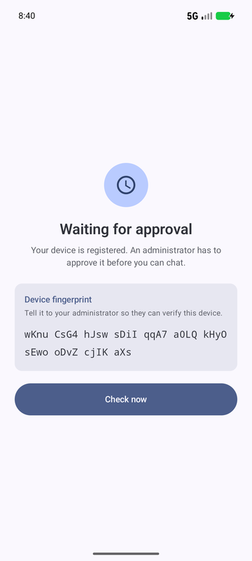 | 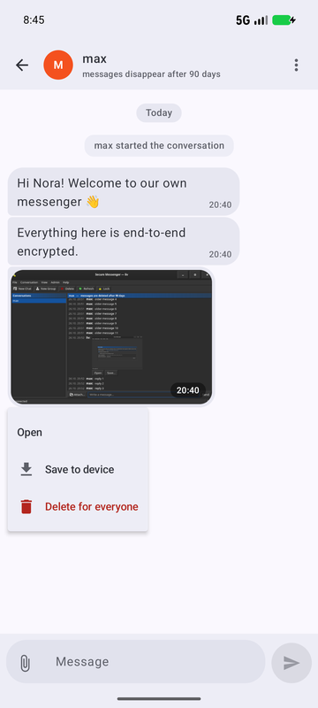 |
| Device setup | Waiting for approval (fingerprint) | Image message, long-press menu |
| 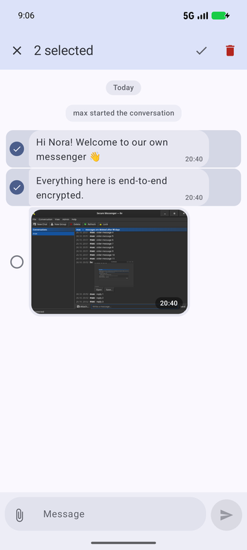 | 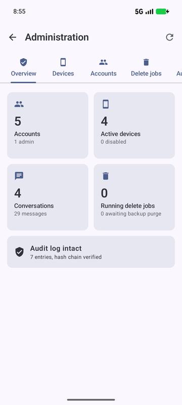 | 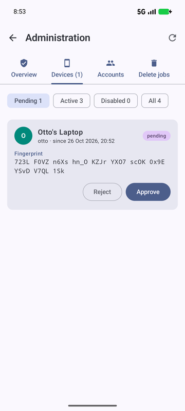 |
| Selecting messages to delete | Administration: overview | Approving a device |
| 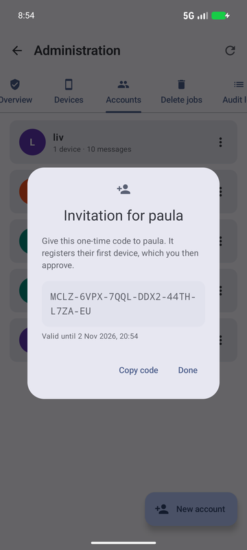 | 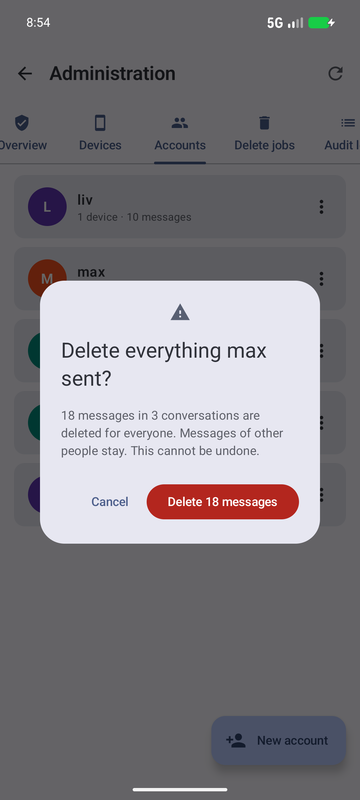 | |
| New account with invitation code | Deleting everything a person sent | |

**Linux** (GTK4, classic desktop look, follows the system theme):

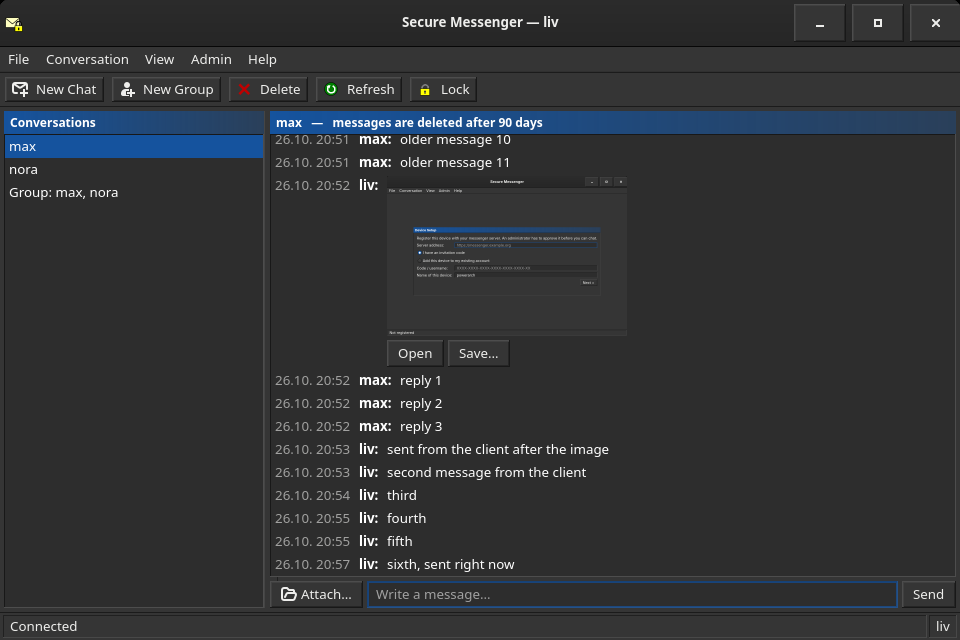

## Quick start

```sh
# 1. Server (on the machine that hosts it)
scripts/install-server.sh --lan              # PostgreSQL + ssm-server as a systemd service, reachable in your LAN
sudo ssm-tui                                 # create accounts (invitation codes), approve devices
scripts/backup.sh --install                  # daily encrypted backups (keep the key file off the server)
scripts/setup-https.sh --domain chat.example.org --email you@example.org   # optional: HTTPS for the internet

# 2. Linux client
scripts/install-linux-client.sh --install-deps

# 3. Android app
scripts/build-android-apk.sh                 # debug APK → ./ssm-debug.apk
scripts/build-android-apk.sh --create-key    # once, for signed releases
scripts/build-android-apk.sh --release       # → ./ssm-release.apk
```

In the app, enter the server address (e.g. `http://192.168.1.10:8080` in the LAN or `https://chat.example.org`), the invitation code and an unlock pattern, then approve the device in `ssm-tui` or the admin panel.

## Documentation

- [SECURITY.md](docs/SECURITY.md) – how the security works (English, with diagrams)
- [Threat model](docs/threat-model.md), [PRD](docs/PRD.md), [TDD](docs/TDD.md), [ADRs](docs/adr/README.md) (German)
- [OpenAPI](server/openapi.yaml) – server API

## Layout

| Path | Content |
|---|---|
| `crates/ssm-core` | 5×5 unlock pattern, pattern-protected key container, lockout policy, Olm/Megolm E2EE store (vodozemac), media encryption |
| `crates/ssm-proto` | Shared API types and signed-message formats |
| `crates/ssm-client` | Device client library: enrollment, sync, messaging, media, deletion, admin client, wake-up channel |
| `crates/ssm-ffi` | UniFFI bindings of the client library for Android |
| `server` | `ssm-server` (axum + PostgreSQL; `ssm-server tui` for management), `ssm-admin` CLI, `openapi.yaml` |
| `clients/linux` | GTK4 desktop client with a classic look (`ssm-linux`), optional TPM2 binding |
| `clients/android` | Android app (Kotlin, Jetpack Compose, Material 3) |
| `scripts` | Install, build, HTTPS, backup and restore scripts |

## Status

| Phase | State |
|---|---|
| 0 ADRs, threat model | done (`docs/adr`, `docs/threat-model.md`, `docs/SECURITY.md`) |
| 1 Server foundation | done: invites, enrollment, approval, sessions, admin API, audit log, events, WebSocket, OpenAPI |
| 2 Client core | done: pattern container, Olm/Megolm, client library, Android Keystore, optional TPM2 on Linux |
| 3 1:1 chats | done (Linux, Android) |
| 4 Deletion, retention | done, including media and deleting several/all messages |
| 5 Groups | done (membership, admin role, session rotation) |
| 6 Media | done: per-file encryption, previews, open/save with warning (Linux, Android) |
| 7 Admin | done: `ssm-server tui`, `ssm-admin`, admin panel in the Linux client and the Android app |
| 8 Push, hardening | done: UnifiedPush/FCM, rate limits, audit role, HTTPS setup, backups, release signing; external pentest open |

## Development

```sh
cargo test --workspace     # server tests download a temporary PostgreSQL on first run
cargo clippy --workspace --all-targets
```

Run the server locally against your own PostgreSQL:

```sh
export SSM_DATABASE_URL=postgres://user@localhost/ssm
cargo run -p ssm-server --bin ssm-admin -- dev-keygen --out admin.key   # prints the admin public key
cargo run -p ssm-server --bin ssm-admin -- bootstrap --username root --admin-public-key <key>
SSM_BIND=127.0.0.1:8080 cargo run -p ssm-server
cargo run -p ssm-server -- tui  # management TUI (same SSM_DATABASE_URL, on the server host)
cargo run -p ssm-linux          # GTK client; accounts in ~/.local/share/ssm-messenger/profiles
cargo run -p ssm-linux -- --account alice   # open one account directly (several windows possible)
```

Demo data (two steps, approve the devices in between, e.g. via SQL in development):

```sh
cargo run -p ssm-client --example demo -- enroll <server> <dir> <invite> <device-name>
cargo run -p ssm-client --example demo -- chat <server> <alice-dir> <bob-dir> [<carol-dir>]
```

## Scripts

| Script | Purpose |
|---|---|
| `scripts/install-server.sh` | Build, install PostgreSQL + `ssm-server` + `ssm-admin`, systemd unit; `--lan` makes it reachable from the local network (`http://<ip>:8080`) |
| `scripts/setup-https.sh` | Caddy with Let's Encrypt in front of the server (`--domain`, `--email`) |
| `scripts/backup.sh` | `--install`: daily encrypted backups (age) of database, media and config; `sudo ssm-backup` runs one |
| `scripts/restore.sh` | Restore a backup and re-apply deletions made since (`--identity KEYFILE BACKUP`) |
| `scripts/install-linux-client.sh` | Build and install the GTK4 client (`--install-deps`, `--system`, `--no-tpm`) |
| `scripts/build-android-apk.sh` | Build the APK into `./ssm-<variant>.apk`; `--create-key` once, then `--release` for a signed build (signature verified and pinned, versionCode = commit count) |

## Android notes

- Android 17+ asks for **nearby devices / local network** access at first start. It is needed to reach a
  server on the local network (home server, LAN IP); without it connections time out.
- Emulator testing: the host is `10.0.2.2` only on the emulator's mobile network. Disable emulator Wi-Fi
  (`adb shell svc wifi disable`), otherwise `10.0.2.2` is the virtual router.
- Debug builds allow screenshots when started with `--ez ssm.allowScreenshots true`; release builds always
  set `FLAG_SECURE`.

