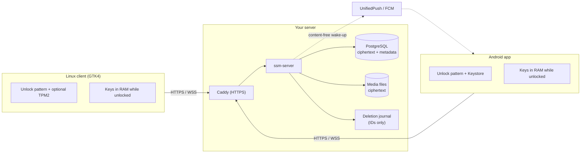
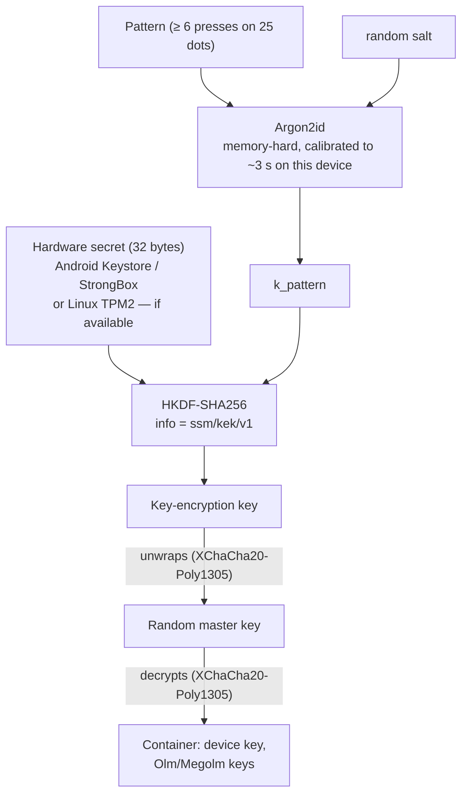
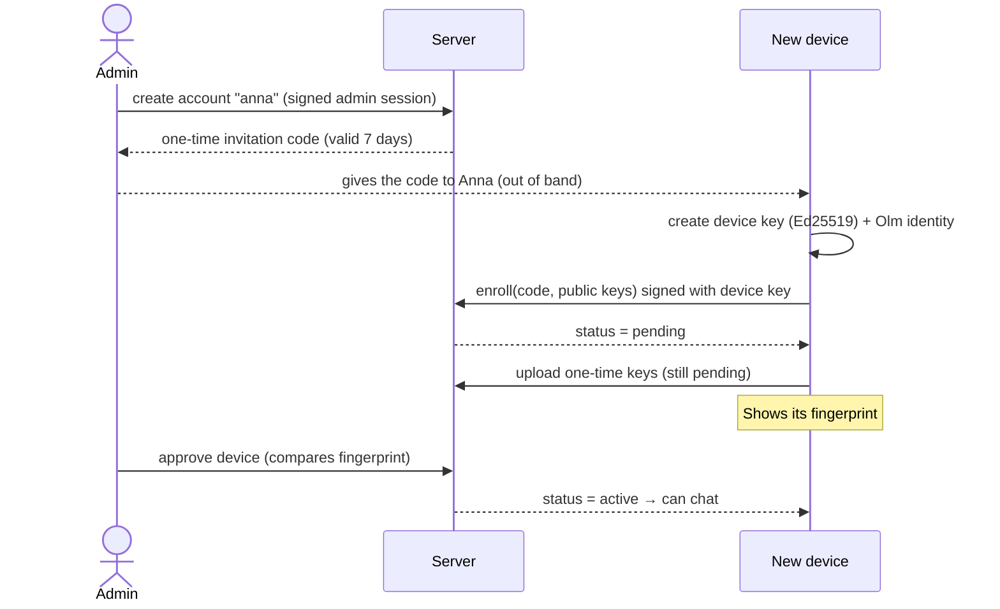
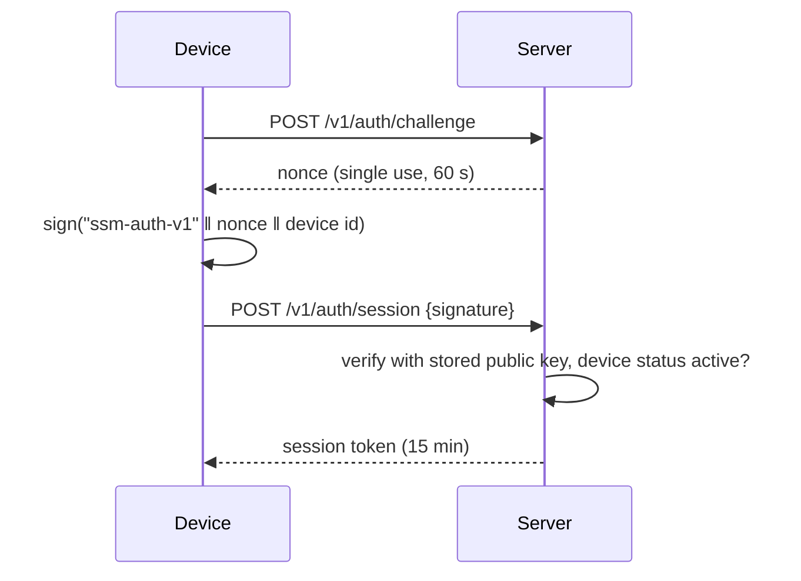
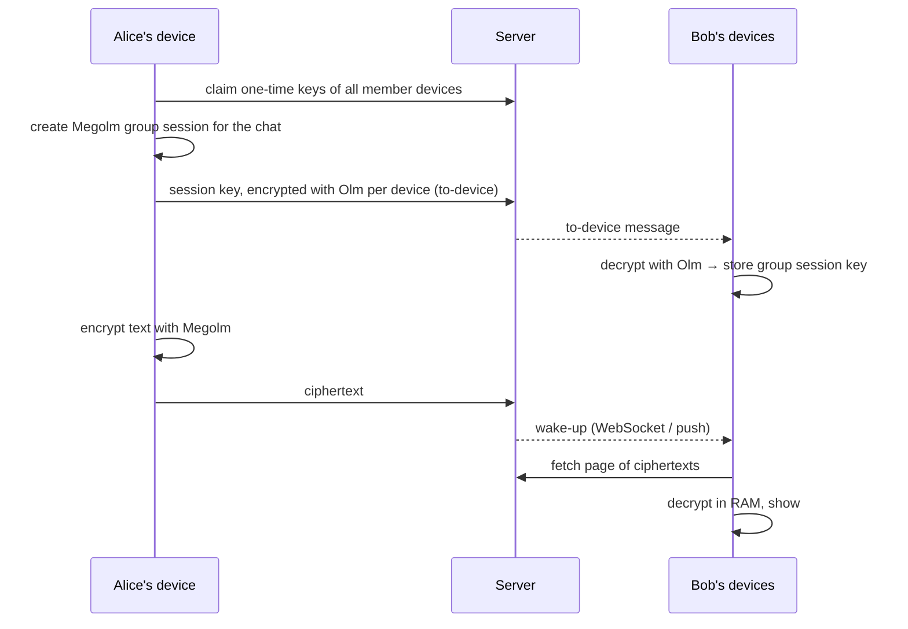
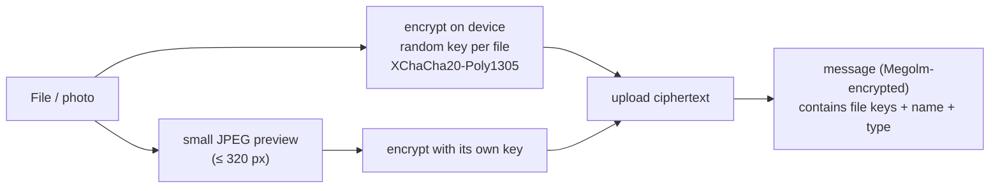
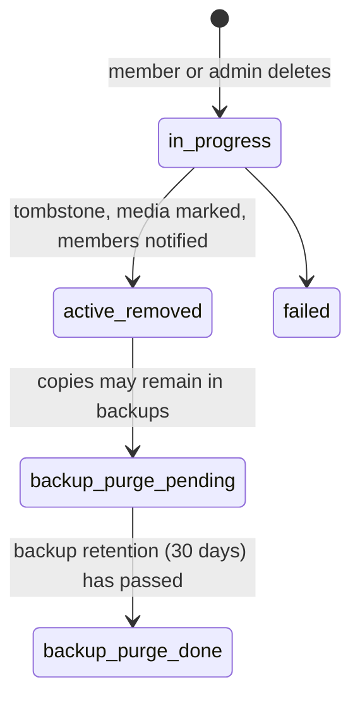
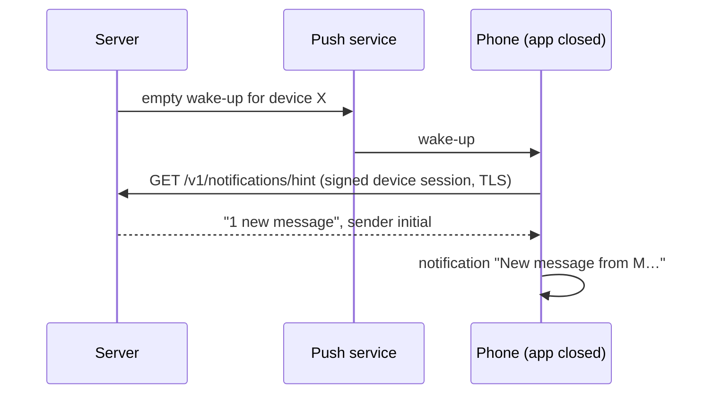

# How the security works

This document walks through the whole system, from the unlock pattern on a phone to the backups on the server, and shows which component can see what. The formal threat analysis (in German) is in [`threat-model.md`](threat-model.md); the design decisions are in [`adr/`](adr/).

**In one sentence:** messages and files are encrypted on the device and only decrypted on the devices of the chat members; the server stores and forwards ciphertext, decides *who may do what*, and can delete — but it can never read.

## 1. Components and what they can see

| Who | Sees | Never sees |
|---|---|---|
| Chat member's device (unlocked) | Plaintext of the conversations it belongs to, from the moment it was approved | Other conversations, messages from before it was approved or joined |
| Server / database / operator | Who is in which conversation, when messages were sent, sizes, device list, audit log | Message text, files, image previews, unlock patterns, private keys |
| Push service (ntfy, Google) | That *a* device should wake up | Sender, conversation, content |
| Someone with a stolen, locked phone or a copied profile | Encrypted key container | Anything readable without the pattern (and, where present, the hardware chip) |

## 2. Unlocking a device: pattern → keys

Every device keeps its private keys in one encrypted file, the *key container*. It is opened with a **pattern on a 5×5 dot grid**: at least 6 presses, any order, dots may repeat (up to 64 presses). The pattern never leaves the device.

- **Wrong patterns** are counted. From the 5th failure on, each further attempt has to wait (30 s, 60 s, … up to 1 hour), also across restarts.
- **Hardware binding:** on Android a random secret is sealed with a non-exportable Keystore key (StrongBox when the phone has it). On Linux, if the client is built with TPM support and the TPM is accessible, a secret is sealed in the TPM (`tpm.seal`). A copied container is then useless on another machine. **Without a TPM everything still works**; the pattern and Argon2id alone protect the container (documented residual risk).
- **Admin key:** administrators have a second container with its own, separate pattern (also Keystore-bound on Android).
- **Locking** (button, app in background, inactivity) drops all keys and every decrypted message from memory.

## 3. Joining: invitation, enrollment, approval

Accounts exist only because an administrator created them. Every new device must additionally be approved.

A pending device cannot read or send anything. Further devices of the same person register with the username and also need approval. Revoking a device deletes it completely, and it is signed out immediately.

## 4. Proving who you are: challenge–response, no passwords

There are no passwords. A device signs a fresh server challenge with its private key:

- Signed data is framed as `domain || (u32le length || field)*`, so signatures for one purpose can never be replayed for another.
- The server re-reads the device and account status on **every request**: disabling or revoking takes effect immediately, and open WebSockets are closed.
- **Admin sessions** work the same way with the admin key (10 min). Destructive admin actions (revoke, mass deletion, admin rights, account deletion) need an **additional fresh signature** over the action and its target.

## 5. Messages: end-to-end encryption

The cryptography is [vodozemac](https://github.com/matrix-org/vodozemac) (Olm/Megolm, the audited implementation behind Matrix). Nothing is self-made.

- **Group sessions rotate** when members change (removed members cannot read later messages), after 100 messages, and after 7 days.
- **No message history on the device.** Clients store only keys; they load ciphertext page by page (100 per page) and decrypt in memory. Leaving a chat or locking drops the plaintext.
- **New devices** can read only what was sent after their approval (no key sharing between your own devices in version 1).

## 6. Pictures and files

The server stores only `nonce || ciphertext` and the size. Chats show the preview; the original is only downloaded on an explicit *Open* or *Save*. Saving to the phone or PC shows a warning that the copy is outside the app's control. Files are limited to 64 MiB; uploads that are never sent are removed after an hour.

## 7. Deleting: only "for everyone"

There is deliberately no "delete only for me". Every deletion removes the content for all participants, and every member of a conversation may delete any message (one, several, or all at once).

- Message expiry (1–365 days per chat, default 90; every change is announced in the chat) uses the same path.
- Offline devices receive the deletion events when they reconnect.
- Administrators can delete **everything one person ever sent** (after a summary and a confirmation signature), or delete an account completely.
- The server never claims "completely gone" while backups may still hold a copy.
- **Restores cannot bring deleted content back:** the IDs of deleted messages and accounts are kept in a journal outside the database for the backup retention period. After restoring an older backup, `restore.sh` replays it and deletes them again.

## 8. Notifications without content

The push service learns only *that* something happened. The phone asks the server over TLS for a minimal hint and shows at most the sender's initial. On Linux a WebSocket connection is used instead.

## 9. Administration and the audit log

- Admins authenticate with their admin key (see 4.). Normal accounts cannot call admin endpoints, and admin rights never give access to message content or keys.
- The server refuses to let admins lock themselves out, remove their own admin role or delete their own account. The operator always has `sudo ssm-tui` on the server as a fallback.
- Every admin action is written to an **append-only, hash-chained audit log**: `hash = SHA-256(previous hash || entry)`.
  - A database trigger forbids UPDATE, DELETE and TRUNCATE.
  - The table belongs to a separate database role; the server itself may only read and insert, so it cannot disable the trigger either.
  - `ssm-ctl verify-audit` and the admin overview check the chain.

## 10. Server and network hardening

| Measure | Details |
|---|---|
| TLS | `scripts/setup-https.sh`: Caddy with Let's Encrypt, HSTS. The server itself listens only locally or in the LAN. |
| Who may connect | Plain HTTP only for loopback and private/VPN addresses (home network, Tailscale); public addresses are refused unless explicitly allowed. |
| Rate limits | 30/min per IP for login and enrollment; per session 600 requests, 60 uploads, 120 admin requests per minute. |
| Authorisation | Checked on the server for every object: conversation membership, "joined after" boundaries, admin role. |
| Replay protection | Single-use nonces, idempotency keys for sends and deletions. |
| Service isolation | systemd sandbox (no new privileges, read-only system, private /tmp, no devices); PostgreSQL via Unix socket with peer authentication, so no database password exists. The management TUI runs as the unprivileged service user; changing port or LAN access goes through one root-owned helper (`ssm-netconfig`) that a sudo rule allows and that validates its arguments, restarts the service and rolls back if it does not come up. |
| Push endpoints | Only `https://` and public addresses (no requests into your LAN unless enabled for a local ntfy). |
| Backups | `scripts/backup.sh`: daily, encrypted with [age](https://age-encryption.org) to a public key; the private key belongs off the server. |
| Releases | Signed APKs; the build refuses a different signing key; `versionCode` always increases, so Android blocks downgrades. |

## 11. On the devices

- **Android:** `FLAG_SECURE` blocks screenshots and recent-apps previews; nothing is backed up by Android backup; files are only exported through the system's save dialog after a warning.
- **Linux:** profile files are readable only by the user; the process is not dumpable (no core dumps with plaintext); no temporary plaintext files.
- Both clients lock automatically and then forget every decrypted message.

## 12. What this system does *not* protect against

Honest limits, accepted on purpose (details in [`threat-model.md`](threat-model.md)):

1. **The operator approves devices.** A malicious operator could approve a device of their own for someone's account. It would only see *new* messages; check your device list and fingerprints.
2. **Metadata** (who talks to whom, when, how much) is visible to the server.
3. **Without a TPM or Keystore**, a copied profile is protected only by the pattern and Argon2id. Long patterns help.
4. **People can copy what they see**: saved files, photos of the screen, screenshots on Linux.
5. **A compromised, unlocked device** can read what that device can read.
6. **Backups** keep deleted (encrypted) data until the retention period ends — this is shown as `backup_purge_pending`.
7. **Plain HTTP in the LAN** (`--lan`) exposes metadata and short-lived session tokens to others on the same network; use HTTPS on networks you do not trust.
